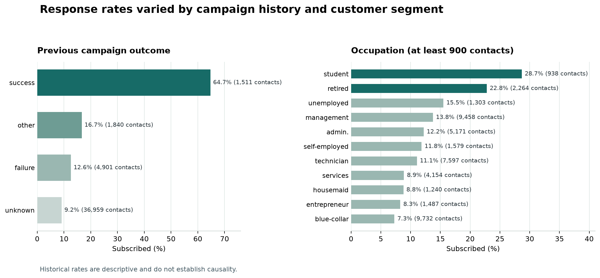

# Bank Campaign Response Analytics

A portfolio project analyzing a bank telemarketing campaign and estimating which customers are more likely to subscribe to a term deposit. The workflow combines Python analysis, PostgreSQL queries, an Excel dashboard, and a binary classification model.

## Business problem

The campaign dataset is highly imbalanced: only 5,289 of 45,211 contacts subscribed. The analysis explores how response rates vary across customer and campaign segments. The model compares a small set of classifiers for prioritizing follow-up contacts, with `duration` excluded because call duration is only known after the call.

This is an educational analysis of historical data, not a production targeting system.

## Dataset

The project uses the [UCI Bank Marketing dataset](https://archive.ics.uci.edu/dataset/222/bank+marketing), specifically `bank-full.csv` (45,211 rows and 17 columns; semicolon-delimited). The target `y` records whether the customer subscribed (`yes` or `no`). The source data describes marketing campaigns run by a Portuguese bank.

Download the dataset from UCI and place `bank-full.csv` in `data/raw/`. Raw and processed CSV files, local model files, and credentials are excluded from Git.

## Tech stack

- Python: pandas, NumPy, scikit-learn, matplotlib, seaborn
- PostgreSQL: schema, analytics, and data quality queries
- Excel: KPI and campaign dashboard
- Jupyter notebooks and pytest

## Workflow

1. Inspect the source schema, target distribution, and basic data quality.
2. Normalize category values, remove duplicate records, and handle missing targets using `src/data_processing.py`. Missing categorical values are retained as `unknown`; `pdays = -1` is preserved as a dataset sentinel.
3. Explore response rates and numeric feature distributions in the EDA notebook.
4. Compare Logistic Regression, Decision Tree, Random Forest, and MLP models. A stratified 60/20/20 train/validation/test split is used: validation selects the model, and the test set is reserved for the final evaluation.
5. Load the cleaned data into PostgreSQL for campaign and data quality queries, and create an Excel dashboard.

The modeling pipeline fits preprocessing on training data. `duration` is excluded to avoid post-call information leakage. Other campaign fields should only be used at prediction time if their values are known then.

## Key findings

The overall subscription rate is **11.70%**. Historical response rates were highest for customers whose previous campaign outcome was successful, and were also higher among student and retired customers. These are descriptive differences and may reflect other factors; they do not show that a customer segment or contact strategy causes subscription.

| Segment | Subscriptions / contacts | Response rate |
| --- | ---: | ---: |
| Previous outcome: success | 978 / 1,511 | 64.73% |
| Job: student | 269 / 938 | 28.68% |
| Job: retired | 516 / 2,264 | 22.79% |
| Contact month: May | 925 / 13,766 | 6.72% |



*Historical rates are descriptive. Sample sizes are shown beside each bar; occupation chart includes segments with at least 900 contacts.*

### Business recommendations

- Consider a controlled follow-up pilot for customers with a successful previous campaign outcome. Measure incremental subscriptions against a comparison group before changing allocation.
- Test tailored messaging for student and retired customers, while tracking contact cost and conversion volume. Do not exclude other customers based on these aggregate rates.
- Review why May generated a low response rate despite the largest contact volume. Check campaign timing, channel mix, and operational context before drawing conclusions.

## Model results

The fixed model configurations are compared on the validation set. The MLP was selected by F1 for the `yes` class, with Average Precision as the next ranking criterion. The selected model was refit on the combined training and validation data before final evaluation.

| Model | Precision (yes) | Recall (yes) | F1 (yes) | ROC-AUC | PR-AUC (Average Precision) |
| --- | ---: | ---: | ---: | ---: | ---: |
| Logistic Regression | 0.2673 | 0.6285 | 0.3751 | 0.7700 | 0.4086 |
| Decision Tree | 0.2908 | 0.6163 | 0.3952 | 0.7725 | 0.4144 |
| Random Forest | 0.6133 | 0.2098 | 0.3127 | 0.7884 | 0.4319 |
| MLP | 0.3648 | 0.6134 | **0.4575** | **0.7937** | **0.4376** |

Final metrics for the selected MLP on the 9,043-row test set:

| Metric | Test result |
| --- | ---: |
| Precision (yes) | 0.3720 |
| Recall (yes) | 0.5784 |
| F1 (yes) | 0.4528 |
| ROC-AUC | 0.7900 |
| PR-AUC (Average Precision) | 0.4350 |
| Accuracy | 0.8364 |

These results come from the executed notebook with `RANDOM_STATE = 42`. The decision threshold is 0.5, and the class-weighted model's probabilities have not been calibrated. Model configurations were fixed for comparison; a broader hyperparameter search was not performed.

## Repository structure

```text
.
|-- data/                 # Local raw and processed CSV files (not tracked)
|-- models/               # Locally generated model (not tracked)
|-- notebooks/            # Data inspection, EDA, ML, SQL, and Excel workflows
|-- reports/              # Excel dashboard and README chart
|-- sql/                  # PostgreSQL schema and analytics/data quality queries
|-- src/                  # Reusable cleaning, preprocessing, and prediction code
|-- tests/                # Unit tests for processing, preprocessing, and prediction
|-- .env.example          # PostgreSQL configuration template
|-- requirements.txt
`-- README.md
```

## Installation and usage

Python 3.10 or newer is recommended. From the project root:

```bash
python -m venv .venv
```

Activate the environment and install dependencies:

```powershell
# Windows PowerShell
.venv\Scripts\Activate.ps1
pip install -r requirements.txt
```

```bash
# macOS / Linux
source .venv/bin/activate
pip install -r requirements.txt
```

Run notebooks 01 through 03 for data inspection, cleaning, and model training. Notebook 03 writes `models/best_model.joblib`; notebook 05 creates the [Excel dashboard](reports/bank_campaign_dashboard.xlsx). The prediction functions are in `src/predict.py`:

```python
from src.predict import predict_one

result = predict_one({
    "age": 35, "job": "technician", "marital": "married",
    "education": "secondary", "default": "no", "balance": 1000,
    "housing": "yes", "loan": "no", "contact": "cellular",
    "day": 15, "month": "may", "campaign": 2, "pdays": -1,
    "previous": 0, "poutcome": "unknown",
})
```

To run the unit tests:

```bash
python -m pytest tests/ -v
```

Notebook 04 requires a running PostgreSQL instance and a project database. Create the database with `psql -U postgres -c "CREATE DATABASE bank_campaign_db;"`, copy `.env.example` to `.env`, enter the connection settings, and run the notebook. It replaces the contents of the `bank_campaign` table with the project dataset inside a transaction; use a dedicated database. Never commit `.env`.

## Limitations

- The data represents historical campaigns in Portugal and may not generalize to other banks, countries, or current campaigns.
- The split is stratified and random, not a forward-in-time evaluation. The source does not include a complete contact date suitable for a temporal holdout.
- Model settings and the 0.5 decision threshold were not tuned to campaign costs. The output probabilities are not calibrated.
- Segment comparisons are observational and do not establish causal effects. A randomized campaign test is needed to estimate incremental impact.
- The model is a prioritization exercise, not a substitute for customer consent, compliance review, or human judgment.

## References

- Moro, S., Cortez, P., & Rita, P. (2014). "A data-driven approach to predict the success of bank telemarketing." *Decision Support Systems*, 62, 22-31. [DOI: 10.1016/j.dss.2014.03.001](https://doi.org/10.1016/j.dss.2014.03.001)
- [UCI Bank Marketing dataset](https://archive.ics.uci.edu/dataset/222/bank+marketing). DOI: [10.24432/C5K306](https://doi.org/10.24432/C5K306)
